 

   

## About

AI Engineering graduate (B.Sc. 2026). I build small, complete AI systems and test them honestly: retrieval-augmented generation, multi-agent workflows, LLM evaluation, computer vision and Arabic NLP. Every project below has tests, CI and a README that states what it does **and what it does not**. Numbers are measured on held-out data, small samples are labelled as small, and rule-based parts are labelled as rules.

My graduation project, **FireGuard**, was graded *Excellent with Honors* (team of 8, my role: backend deployment).

## Projects

Click a logo to open the repo.

### LLM, RAG and agents

<table>
<tr><td align="center" width="25%" valign="top"><a href="https://github.com/mostafaabdoelgohary2003AI/bilingual-rag"> <b>Bilingual RAG</b></a> Arabic/English answers with citations</td><td align="center" width="25%" valign="top"><a href="https://github.com/mostafaabdoelgohary2003AI/agentic-job-assistant"> <b>Agentic Job Assistant</b></a> LangGraph agents, critique loop, human approval</td><td align="center" width="25%" valign="top"><a href="https://github.com/mostafaabdoelgohary2003AI/llm-eval-kit"> <b>LLM Eval Kit</b></a> F1, groundedness, hallucination flags, LLM judge</td><td align="center" width="25%" valign="top"><a href="https://github.com/mostafaabdoelgohary2003AI/nl2sql-agent"> <b>NL2SQL Agent</b></a> Read-only safety gate, golden benchmark</td></tr>
<tr><td align="center" width="25%" valign="top"><a href="https://github.com/mostafaabdoelgohary2003AI/ops-autopilot"> <b>Ops Autopilot</b></a> Planner, researcher, writer, critic, DOCX</td><td align="center" width="25%" valign="top"><a href="https://github.com/mostafaabdoelgohary2003AI/retention-copilot"> <b>Retention Copilot</b></a> Churn dashboard, Arabic assistant, agents</td><td align="center" width="25%" valign="top"><a href="https://github.com/mostafaabdoelgohary2003AI/arabic-rag-chatbot"> <b>Arabic RAG Chatbot</b></a> e5 + FAISS retrieval, AraELECTRA reader</td><td align="center" width="25%" valign="top"><a href="https://github.com/mostafaabdoelgohary2003AI/arabic-nlp-toolkit"> <b>Arabic NLP Toolkit</b></a> Preprocessing, language and dialect ID</td></tr>
</table>

### Machine learning and vision

<table>
<tr><td align="center" width="25%" valign="top"><a href="https://github.com/mostafaabdoelgohary2003AI/churn-insight-platform"> <b>Churn Insight Platform</b></a> FastAPI, Docker, CI, SQL migrations</td><td align="center" width="25%" valign="top"><a href="https://github.com/mostafaabdoelgohary2003AI/telco-churn-lab"> <b>Telco Churn Lab</b></a> Eight-model benchmark, test set used once</td><td align="center" width="25%" valign="top"><a href="https://github.com/mostafaabdoelgohary2003AI/sat-vision-service"> <b>SAT Vision Service</b></a> ResNet18 on EuroSAT, FastAPI + web UI</td><td align="center" width="25%" valign="top"><a href="https://github.com/mostafaabdoelgohary2003AI/doc-scan-pro"> <b>Doc Scan Pro</b></a> OpenCV: phone photo to print-ready scan</td></tr>
</table>

### Graduation project

<table>
<tr><td align="center" width="25%" valign="top"><a href="https://github.com/mostafaabdoelgohary2003AI/fireguard-graduation-project"> <b>FireGuard</b></a> Graduation project: fire and smoke detection, alerts</td><td align="center" width="25%" valign="top"><a href="https://github.com/mostafaabdoelgohary2003AI/FireGuard-Documentation"> <b>FireGuard Docs</b></a> System documentation for FireGuard</td><td width="25%"></td><td width="25%"></td></tr>
</table>

<b>More repositories</b> (coursework and earlier work)

<table>
<tr><td align="center" width="25%" valign="top"><a href="https://github.com/mostafaabdoelgohary2003AI/Heart-Disease-Prediction-ML-Pipeline"> <b>Heart Disease ML</b></a> Prediction pipeline</td><td align="center" width="25%" valign="top"><a href="https://github.com/mostafaabdoelgohary2003AI/Monkeypox-Detection-Pipeline"> <b>Monkeypox Detection</b></a> Detection pipeline</td><td align="center" width="25%" valign="top"><a href="https://github.com/mostafaabdoelgohary2003AI/Diabetes-Prediction"> <b>Diabetes Prediction</b></a> Classical ML</td><td align="center" width="25%" valign="top"><a href="https://github.com/mostafaabdoelgohary2003AI/COVID-19-EDA"> <b>COVID-19 EDA</b></a> Exploratory analysis</td></tr>
<tr><td align="center" width="25%" valign="top"><a href="https://github.com/mostafaabdoelgohary2003AI/Warsaw-EV-Charging-Analysis"> <b>Warsaw EV Charging</b></a> 114k sessions, 67 stations</td><td align="center" width="25%" valign="top"><a href="https://github.com/mostafaabdoelgohary2003AI/Transformer-Language-Model-with-Masked-Language-Modeling"> <b>Transformer MLM</b></a> Masked language model</td><td align="center" width="25%" valign="top"><a href="https://github.com/mostafaabdoelgohary2003AI/GANs-Implementations"> <b>GANs</b></a> Implementations</td><td align="center" width="25%" valign="top"><a href="https://github.com/mostafaabdoelgohary2003AI/Ra7al-Tourist-Website"> <b>Ra7al</b></a> Tourism website</td></tr>
<tr><td align="center" width="25%" valign="top"><a href="https://github.com/mostafaabdoelgohary2003AI/Hospital-Management-System"> <b>Hospital Mgmt System</b></a> Python app</td><td width="25%"></td><td width="25%"></td><td width="25%"></td></tr>
</table>

## Measured results

| Project | Result | Note |
|---|---|---|
| churn-insight-platform | 96.3% accuracy, ROC-AUC 0.992 | Held-out data, public Iranian telecom dataset |
| sat-vision-service | 94.1% accuracy | EuroSAT, 10 classes, held-out |
| arabic-rag-chatbot | hit@5 97.3%, exact match 33.3%, F1 46.9% | XQuAD-Arabic, reported as measured |
| telco-churn-lab | 79.9% accuracy, ROC-AUC 0.836 | 5-fold CV, test set used once |
| nl2sql-agent | rules 15/15, LLM only 6/15 | Golden-SQL benchmark; the LLM-only score is the honest gap |
| retention-copilot | 3/3 LLM drafts passed the Critic | Gemini 3.1 Flash-Lite, tiny run, not a benchmark |
| llm-eval-kit | LLM judge mean 0.50 vs heuristic 0.435 | Small labelled set; hallucination rate 0.4 vs 0.2 |
| bilingual-rag | hit@3 1.0 | Only 4 questions, a smoke test, not a benchmark |

## Stack

             

## Training and certificates

- **Microsoft ML Engineering Trainee, DEPI** (Oct 2024 to May 2025). Recognized as Top Performing Trainee, Round 2, Dakahlia Governorate.
- **NVIDIA DLI** Generative AI summer training (ITI, Sep 2025) and *Building LLM Applications with Prompt Engineering*
- **Huawei** HCIA-AI V3.5 (NTI, ETA program, 2025)
- **Azure AI Engineer (AI-102) course**, certificate of completion (CLS Learning Solutions), not the Microsoft exam
- Google Cloud *Introduction to Large Language Models*, IBM *AI Fundamentals*, AWS Educate *Machine Learning Foundations*, DeepLearning.AI *Supervised ML* and *Advanced Learning Algorithms*

Built with AI pair-programming help, tested and measured by me.

